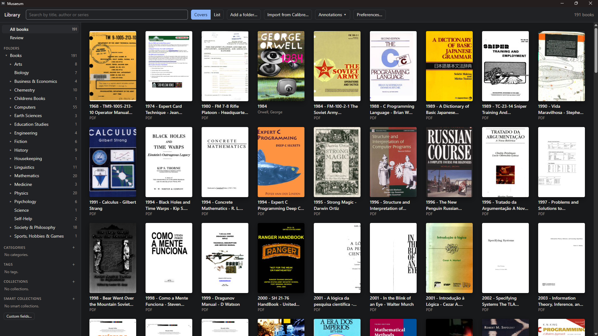
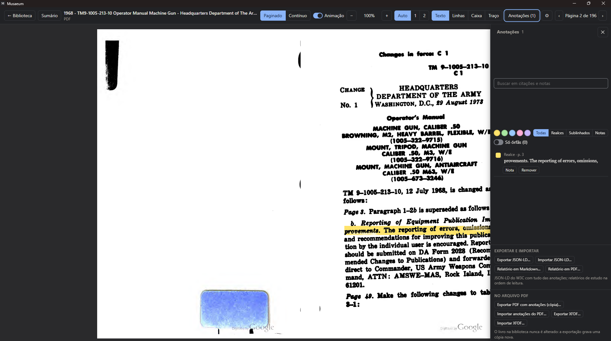
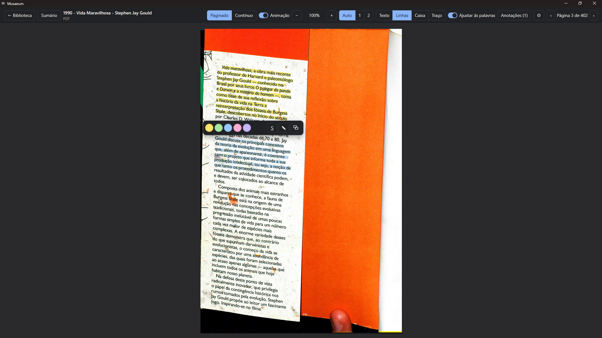

# Musaeum

*[Leia em Português (Brasil)](README.pt-BR.md)*

Free and open-source digital book reader and library manager (`GPL-3.0-or-later`).

<p align="center">
  
  <br>
  <em>The integrated digital book library showing covers and taxonomy</em>
</p>

**Version 1.0.0**, for Windows 10 and 11 (x64). Version history is in
[`CHANGELOG.md`](CHANGELOG.md), and build, verification, and code-signing instructions are in
[`docs/release.md`](docs/release.md).

<p align="center">
  
  
  <br>
  <em>High-fidelity digital reading & annotations (left); curved-line detection & on-demand Tesseract OCR on scanned pages (right)</em>
</p>
## Install

Download `Musaeum_1.0.0_x64-setup.exe` and run it: it installs per-user without requiring administrator
privileges, in Brazilian Portuguese or English. For multi-user deployments, machine-wide MSIs are also
available (`Musaeum_1.0.0_x64_pt-BR.msi` or `..._en-US.msi`). Nothing else is required: WebView2 is
already bundled with Windows 11 (on machines without it, the installer downloads it from Microsoft), and
the Visual C++ runtime is statically linked into every executable. Uninstalling removes only the
program, never your library, annotations, or preferences.

Installers in this release are not code-signed, so Windows SmartScreen may display an unknown publisher
warning. Always verify the SHA-256 checksum of the downloaded file against the published hash
(`Get-FileHash <file> -Algorithm SHA256`).

## What Musaeum Guarantees

- **Your books are strictly read-only.** Musaeum never writes inside any watched book folder—not the
  database, cache, exports, study reports, or annotated PDF copies. The library, cache, and preferences
  live in `%LOCALAPPDATA%\Musaeum` (or the directory passed via `--library`), and the app refuses to
  watch any folder containing those files. A file on disk only changes through an explicit user command
  in the CLI (`musaeum move`), backed by a journal and undo support.
- **Nothing is ever silently lost.** A missing file stays marked as absent with all attached data
  intact; an annotation whose passage can no longer be found becomes orphaned and remains listed, never
  deleted; database triggers block deletions that would cause data loss.
- **Every book file is treated as hostile input.** Each format is parsed and rendered in an isolated
  worker process running with a restricted low-integrity token, process mitigations, a dedicated job
  object, and a separate window station: no network, no file opens by path, and no child process
  spawning. The comics, DjVu, OCR, and ingest workers also block `win32k` and allow only
  Microsoft-signed DLLs. Both automated tests and the installed app verify this externally
  (`tools/sandbox-audit`). Reflowable books are normalized before display, stripped of scripts, and
  rendered in a unique per-book origin that cannot reach app IPC commands.
- **Offline by design.** The application makes no network requests. Optional OCR language packs are
  downloaded separately via a script and are only loaded after SHA-256 verification.

## What Exists Today

The project completed its Master Plan through Phase 8: the **Alpha milestone** (a daily-driver library
with an integrated reader), Phase 4 text annotations, Phase 5 scanned-book support, the **Beta
milestone** (full library organization in Phase 6), Phase 7 annotation portability, and Phase 8
preferences, localization, accessibility, and release hardening. Features include:

- **Library & Organization:** Watches chosen folders and displays books as a cover grid or list, with
  instant title search and background full-text search (showing highlighted snippets, page/section, and
  jumping directly to the match). Filter by disk folder, up to 16-level category trees, tags, manually
  ordered collections, and smart collections (rules such as *"author contains Sagan and year between 1980
  and 1999"*).
- **Metadata, Batch Editing, Deduplication & Calibre:** A details panel edits title, people and roles,
  series, year, language, identifiers, rating, reading status, synopsis, and custom fields for a single
  book or multiple selected books at once, using field-level provenance so re-reading files never
  overwrites user edits. Includes a Review view for reconciling duplicate files/works and merging them
  without losing annotations or taxonomy, plus strictly read-only Calibre (`metadata.db` /
  `metadata.opf`) library import.
- **Reflowable & Fixed-Layout Readers:** Reflowable reader for EPUB 2/3, MOBI, AZW3, FB2, TXT, and
  Markdown (normalized in an isolated worker) supporting paginated view with page-turn animations or
  custom continuous scrolling, typography controls, and themes; fixed-layout reader for PDF, comics
  (CBZ/CBR), and DjVu; unified toolbar, table of contents, shortcuts, and exact reading position
  persistence across sessions.
- **Annotations & Scanned Books (OCR):** Highlights, underlines, and Markdown notes across fixed and
  reflowable books with triple-anchor re-anchoring across renames, moves, and new editions, backed by
  the searchable Annotations Inspector. On scanned pages, background line detection locates straight,
  spine-curved, and rotated (45° / 90°) text lines for magnetic line selection, translucent boxes, and
  freehand ink strokes, while isolated Tesseract OCR extracts text for copying and full-text search.
- **Portability & Study Reports:** Export/import native Acrobat- and PDFium-compatible PDF annotations
  (always into a new copy), strict anti-XXE XFDF, lossless W3C Web Annotation JSON-LD (single book,
  selection, or entire library), and deterministic Markdown and A4 PDF study reports ordered by reading
  position and chapters.
- **Preferences, Localization & Accessibility:** Full Brazilian Portuguese (`pt-BR`) and English (`en`)
  interface and backend localization, system/light/dark themes, `prefers-reduced-motion` support,
  configurable annotation author name, verified OCR language selection, safe cache cleanup, keyboard
  navigation, focus management, and verified WCAG AA contrast.

Architectural decisions and measurements for every phase are documented in
[`docs/adr/0001-fase-0.md`](docs/adr/0001-fase-0.md) through
[`docs/adr/0015-fase-8-parte-2-release-1-0.md`](docs/adr/0015-fase-8-parte-2-release-1-0.md)
*(in Portuguese)*.

Currently, Musaeum builds and runs only on **Windows**.

## Architecture

```text
 musaeum-desktop.exe (Tauri 2)                       isolated processes, one per task
 ┌──────────────────────────────────────────┐        ┌──────────────────────────────────────┐
 │ WebView2: app UI (React, React Aria),    │        │ musaeum-render-pdf      PDFium       │
 │ WebGL2 compositor in a Web Worker,       │  tiles │ musaeum-pdf-annots      PDFium       │
 │ and each reflowable book in its own      │◄──────►│ musaeum-render-raster   libarchive   │
 │ origin, without IPC                      │  shm   │ musaeum-render-djvu     DjVuLibre    │
 ├──────────────────────────────────────────┤ + pipe │ musaeum-ocr             Tesseract    │
 │ Rust host: commands validating every     │        │ musaeum-ingest          metadata,    │
 │ page request, library (SQLite, Tantivy), │        │                         normalizer   │
 │ tiles, and cache                         │        └──────────────────────────────────────┘
 └──────────────────────────────────────────┘          restricted token, low integrity,
                                                       job object, mitigations, no network
```

Only the Rust host opens files: it passes each worker a read-only handle to the book (or raw bytes over
a pipe) and treats every worker response as untrusted. The frontend talks to the host exclusively
through validated IPC commands; it cannot supply arbitrary file paths to read or write (paths come from
system dialogs), and its Tauri permissions are restricted strictly to event listeners. The core crates
(`crates/`) have no Tauri dependency and are shared directly with the CLI.

## Repository Structure

```text
crates/
  musaeum-shm/         Shared-memory protocol: pixel slab, delivery ring, control messages,
                       and tile arithmetic
  musaeum-core/        Pure state-machine scheduler and worker supervisor (no Tauri dependency)
  musaeum-sandbox/     Restricted token, process mitigations, job object, isolated window station
  musaeum-worker/      Shared render worker runtime: handshake, handles, control loop,
                       cancellation, and test harness
  musaeum-render-pdf/  Isolated PDFium tile rasterizer and PDF annotations worker
                       (musaeum-pdf-annots.exe)
  musaeum-pdf-annot/   Native PDF annotation parser, incremental copy writer, strict XFDF
                       parser/serializer, and worker RPC
  musaeum-report/      Study reports: reading-order/chapter sorting, Markdown notes parser,
                       Markdown exporter, and native PDF generator with subsetted Noto fonts
  musaeum-archive/     Vendored libarchive (read-only ZIP, RAR, and RAR5 support)
  musaeum-render-raster/  Isolated comic book renderer (CBZ, CBR)
  musaeum-djvu/        Vendored DjVuLibre behind a C++ bridge
  musaeum-render-djvu/ Isolated DjVu renderer
  musaeum-fs/          128-bit File IDs, open-free directory listing, cloud-placeholder refusal,
                       and overflow-aware filesystem watcher
  musaeum-flow/        Safe-Rust reflowable book normalizer and locator engine (CFI & Locator):
                       DOM, XML/HTML5, sanitizer, CSS, chunking, EPUB/MOBI/KF8/FB2/TXT/MD readers
  musaeum-ingest/      Isolated worker for metadata extraction, PDF catalog flags
                       (`/PageLayout`, `/Direction`), and reflowable normalization
  musaeum-library/     SQLite persistence, file identity, indexer, filesystem journal, reading
                       positions, page geometry, W3C annotations & re-anchoring, JSON-LD exchange,
                       normalized book cache, and line models
  musaeum-vision/      Scanned-page line detector: Sauvola binarization, connected components,
                       skew estimation, banded columns, polyline baselines, rotated text,
                       photo/chart/table masking, perceptual hashing, and labeled test corpus
  musaeum-tesseract/   Tesseract and Leptonica compiled from source behind a C++ bridge
  musaeum-ocr-worker/  Isolated Tesseract worker reading one rectified line at a time
  musaeum-ocr/         Host-side OCR worker protocol and baseline line rectification
apps/cli/              `musaeum` binary: full library access from the command line
apps/desktop/
  src-tauri/           Tauri bridge: `tile://`, `book://`, and `thumb://` protocols, library/index
                       host, cover thumbnails, normalized books, WebView2 buffers, test harness
  src/app/             Library and reader UI (React + React Aria)
  src/fixed/           Main-thread fixed-layout reader controller
  src/                 WebGL2 compositor in a Web Worker: reading modes, spreads, page-turn
                       physics, and tile cache
  src/reader/          Reflowable reader in an isolated origin: paginated view (adapted foliate-js),
                       custom continuous scrolling, anchoring, and typography
vendor/
  foliate-js/          Pinned commit of foliate-js with a documented patch
  libarchive/          libarchive 3.8.11 (read side), documented origin and config.h
  djvulibre/           DjVuLibre 3.5.30 (`libdjvu`)
  tesseract/           Tesseract 5.5.4, Leptonica 1.87.0, and `por`/`eng` models (downloaded via
                       `fetch-ocr.ps1`; only README is checked in)
  fonts/               Noto Sans, Serif, Sans Mono, Sans Math, and Sans Symbols 2 for PDF study
                       reports (downloaded via `fetch-fonts.ps1`)
  third-party.json     License metadata for vendored non-package dependencies
tools/
  fetch-pdfium.ps1     Downloads pinned PDFium build and verifies SHA-256
  fetch-ocr.ps1        Downloads pinned Tesseract, Leptonica, and tessdata models with SHA-256
  fetch-fonts.ps1      Downloads pinned Noto fonts for PDF reports with SHA-256
  gen-fixtures/        Generates test PDFs, comics, DjVu, EPUBs, hostile EPUB, and multi-format book
  pool-bench/          Headless render pool benchmark
  library-bench/       100,000-file library keystroke search benchmark
  corpus-check/        Read-only validation of library, pipeline, normalizer, lines, and PDF annots
  cfi-browser-check.mjs  Validates generated EPUB CFIs in Chrome with foliate-js
  visual-check/        Window-vs-reference visual diffing and PDFium color checks
  e2e-reader.mjs       Real-window reader test: modes, shortcuts, saved position, visual diff
  e2e-alpha.mjs        Real-window Alpha suite: library, reader, and positions across formats
  e2e-taxonomy.mjs     Real-window library taxonomy and details panel suite
  e2e-beta.mjs         Real-window Beta suite: batch edit, review/merge, full-text, Calibre
  e2e-pdf-annotations.mjs  Real-window native PDF annotation copy export/import and XFDF suite
  e2e-exchange.mjs     Real-window W3C JSON-LD round-trip and study reports suite
  e2e-preferences.mjs  Real-window Preferences, i18n, themes, reduced motion, and keyboard suite
  e2e-ipc.mjs          Hostile IPC/ACL probe against the app running without `--e2e`
  sandbox-audit/       External kernel-level sandbox auditor for running worker processes
  stage-bundle.mjs     Stages installer assets and rejects binaries importing the VC++ runtime
  smoke-bundle.mjs     Installs, runs, audits, and uninstalls release bundles outside the repo
  third-party-notices.mjs  Generates `THIRD-PARTY-NOTICES.md` from lockfiles and vendor metadata
  reader-check.mjs     Headless Chrome test for the reflowable reader over normalized books
  lib/cdp.mjs          WebView2 CDP driver for real-window E2E suites
  lib/clipboard.mjs    Clipboard helper preserving/restoring user clipboard across tests
  lib/seam-oracle.mjs  Chunk-seam layout oracle for long reflowable chapters
  lib/calibre-library.mjs  Synthetic Calibre library generator (`lib/calibre-schema.sql`)
  run-bench.mjs        Runs Experiments A and B benchmark matrix
  run-epub-bench.mjs   Measures reflowable reader relayout latency
  measure-memory.mjs   Measures full-application RAM usage
  test-cascade.mjs     Tests automatic pixel-delivery fallback cascade in the real app
  test-epub-security.mjs  Tests each reflowable isolation barrier independently on a hostile EPUB
  check-licenses.mjs   Verifies dependency licenses and `THIRD-PARTY-NOTICES.md` freshness
docs/
  adr/                 Architecture Decision Records and measurements for Phases 0–8
  release.md           Build, audit, packaging, and signing guide
```

## Building and Running

Prerequisites: Rust (pinned in `rust-toolchain.toml`), Visual Studio Build Tools with C++ and the
Windows SDK, Node.js 24, `cargo-deny` (`cargo install cargo-deny`), and the WebView2 runtime (included
in Windows 11). The C/C++ runtime is statically linked in all executables (`.cargo/config.toml`).

```powershell
powershell -ExecutionPolicy Bypass -File tools\fetch-pdfium.ps1
powershell -ExecutionPolicy Bypass -File tools\fetch-ocr.ps1
powershell -ExecutionPolicy Bypass -File tools\fetch-fonts.ps1

cd apps\desktop
npm ci
npm run build:app
cd ..\..

.\target\release\gen-fixtures.exe --out fixtures
```

`npm run build:app` builds the desktop app and workers into `target\release`; `npm run build:bundle`
also builds the Windows installers into `target\release\bundle` ([`docs/release.md`](docs/release.md)).

Launching the app:

```powershell
.\target\release\musaeum-desktop.exe
.\target\release\musaeum-desktop.exe --library D:\MyLibrary
```

When no library exists yet, the app prompts for a book folder or an existing library directory. It stores
its database in `%LOCALAPPDATA%\Musaeum` (or the `--library` path) and never writes inside your book
folders. Single-click selects a book and opens its details; double-click or `Enter` opens the reader;
`← Library` (or `Alt+←`) returns. In the reader, `C` toggles paginated/continuous mode, `A` toggles
page-turn animations, `Aa` opens reflowable typography controls, and `Contents` opens the table of
contents.

To annotate, select text by dragging, double-clicking a word, triple-clicking a line, or
quadruple-clicking a paragraph (fixed layout); selections span page breaks and long-chapter chunk seams.
A floating toolbar offers five highlight colors, underline, Markdown notes with preview, and copy;
clicking an existing mark opens the same toolbar with delete (and undo). `Annotations` opens the
Inspector to filter by color, type, or orphaned status, search accent-insensitively across quotes and
notes, and jump directly to passages.

Opening a document directly (bypassing the library UI):

```powershell
.\target\release\musaeum-desktop.exe --document fixtures\spreads.pdf
.\target\release\musaeum-desktop.exe --document fixtures\comic.cbz
.\target\release\musaeum-desktop.exe --document fixtures\book.djvu
.\target\release\musaeum-desktop.exe --document D:\Books\sample.pdf --library D:\MyLibrary
.\target\release\musaeum-desktop.exe --epub fixtures\large.epub
```

`--document` detects PDF, CBZ, CBR, or DjVu by magic bytes rather than file extension (`--pdf` remains
an alias). Navigation uses arrow keys, Page Up/Down, Space, Home, and End; `Ctrl` with `+`, `-`, `0`,
mouse wheel, or pinch zooms around the cursor. `--tile-budget-mb N` caps GPU tile memory.

Running benchmarks (run on an idle machine; results are written to `bench-results/`):

```powershell
node tools\run-bench.mjs
node tools\run-bench.mjs --scenario quick --uncapped --stress 0
.\target\release\musaeum-desktop.exe --pdf sample.pdf --bench zoom.json --scenario zoom
node tools\run-epub-bench.mjs
node tools\measure-memory.mjs
```

## Command-Line Interface (`musaeum`)

```powershell
cargo build --release -p musaeum-cli -p musaeum-library

.\target\release\musaeum.exe root add D:\Books
.\target\release\musaeum.exe reconcile
.\target\release\musaeum.exe status
.\target\release\musaeum.exe search dostoevsky
.\target\release\musaeum.exe search "dom casmurro" --keystrokes
.\target\release\musaeum.exe inspect D:\Books\sample.pdf
.\target\release\musaeum.exe revisions D:\Books\sample.pdf
.\target\release\musaeum.exe suggestions
.\target\release\musaeum.exe move D:\Books\a.pdf D:\Books\b.pdf
.\target\release\musaeum.exe undo
.\target\release\musaeum.exe watch
```

Run `musaeum --help` for the full command list, and pass `--json` before any subcommand for
machine-readable output. Read-only queries work concurrently while `musaeum watch` is running.

Three invariants govern the library core:

1. **Disk is the source of truth.** OS filesystem events are only hints for where to look first; missed
   events cost latency, never data. The same reconciliation logic covers initial scans, live watching,
   and offline changes.
2. **Nothing is deleted automatically.** Missing files remain marked absent with all metadata and
   annotations preserved. Database triggers prevent deleting confirmed revisions or annotations, and
   disk mutations happen only via explicit journaled commands with undo.
3. **Parsers stay sandboxed.** Reading `/ID[0]` or `dc:identifier` means parsing untrusted bytes, so
   `musaeum-ingest` runs with no network and no path-based file access, receiving each book via a
   duplicated read-only handle.

## Library Organization

- **Sidebar navigation:** *All books*, disk *Folders*, *Categories* (up to 16 nested levels), *Tags*,
  *Collections*, and *Smart collections*. Selecting a category includes its subcategories; collections
  preserve manual ordering. Each item has a `⋯` menu (rename, move, reorder, delete) and each section
  has a `+` action.
- **Smart collections:** Rule builder over 16 standard fields plus custom fields with "all" / "any"
  matching, case- and accent-insensitive, showing live match counts while editing.
- **Details panel:** Single-click selects a book and opens its details; double-click or `Enter` opens
  it. Every field shows its provenance (*"from file"*, *"from Calibre"*, *"edited"*). User edits are
  never overwritten by subsequent file rescans or imports. ISBNs validate their check digit.
- **Custom fields:** Defined once (*Custom fields…*) as text, number, date, boolean, enum, or URL.
- **Multi-select & batch editing:** `Ctrl+click`, `Shift+click`, and `Ctrl+A` (fetching all matching
  IDs from the host, even beyond the virtualized viewport) switch the panel to atomic batch editing for
  people, series, year, language, rating, status, categories, tags, and collections.
- **Review & merge:** Lists reconciliation suggestions and potential duplicate works (shared identifier
  or matching title + primary author). Rejected pairs do not reappear; merging moves all documents,
  annotations, reading positions, and taxonomy onto the chosen target work.
- **Full-text search:** Toggle *Titles / In text* (powered by Tantivy 0.27) for all-word and quoted
  phrase queries across PDF/DjVu text layers, OCR-read scanned lines, and reflowable books, indexed in
  the background under a strict CPU duty-cycle budget. Clicking a match opens the book at the exact page
  or section, and returning preserves search state.
- **Calibre import:** *Import from Calibre…* opens `metadata.db` as an immutable file (refusing import
  during active Calibre writes, with fallback to `metadata.opf`), importing formats, metadata, series,
  tags, ratings, identifiers, stripped HTML comments, and custom columns without modifying a single byte
  in the Calibre folder, deduplicating existing files by BLAKE3.

## Fixed-Layout Reader & Scanned Books

- **Exact-scale tiling:** Tiles rasterize at exact display scale (1/4096 px/pt steps) rather than
  powers of two, resampled smoothly during zoom animations while final-scale tiles arrive before the
  animation ends.
- **Zero-raster geometry & spreads:** Page dimensions and `/PageLayout` are extracted without rasterizing
  and cached in `cache.db` by BLAKE3 hash. Spreads preserve print parity, isolate landscape pages, and
  respect `/PageLayout` and RTL reading order.
- **Self-healing workers:** Crashed or killed workers respawn in tens of milliseconds; tiles that crash
  workers twice are quarantined.
- **Unified multi-format pipeline:** PDF (PDFium), comics (libarchive + Rust decoders), and DjVu
  (DjVuLibre) share one worker protocol. Comic and DjVu workers link statically and run under the
  strictest `LockdownParser` sandbox (no `win32k`, Microsoft-signed DLLs only).
- **Page classification & scanned line detection:** Pages are classified in the background as digital
  text, scanned image, or hybrid. Scanned/hybrid pages are rasterized to 1,500 px grayscale and analyzed
  in ~20 ms (`musaeum-vision`) to detect straight, spine-curved, and rotated (45° / 90°) text lines
  while rejecting photos, halftones, charts, table grids, pencil underlines, and margin scribbles.
  *Lines* mode snaps word-to-word along baseline polylines; *Box* and *Ink* mark arbitrary regions.
- **On-demand isolated OCR:** Drawing a mark with *Lines*, *Box*, or *Ink* rectifies each underlying
  line along its baseline and runs Tesseract 5.5.4 inside `musaeum-ocr.exe` (same strict sandbox).
  Extracted text enables native `Ctrl+C` copying, populates annotation quotes, persists in `cache.db`
  (`ocr_line`), and feeds the full-text search index.
- **Background thumbnails:** Generated at lowest scheduler priority into
  `cache\thumbnails\v1\ab\<hash>\<page>.jpg` (up to 256 px), immediately preempted whenever a visible
  tile needs a worker.

## Native PDF Annotations & XFDF

Inside a PDF's *Annotations* panel, the *In the PDF file* section provides four actions:

- **Export PDF with annotations (copy)…** writes a brand-new copy containing the original book bytes
  verbatim followed by an incremental PDF update with Acrobat- and PDFium-compatible annotations
  (`/Highlight`, `/Underline`, `/Square`, `/Ink`, `/Text`), `/QuadPoints`, UTF-16BE `/Contents`, colors,
  dates, author (`/T`), appearance streams (`/AP`), and stable `/NM` derived from the annotation's
  `UUIDv7`. Before renaming into place, PDFium verifies every annotation and all pre-existing objects.
  Original library files are never modified.
- **Import annotations from PDF…** imports native annotations from the book or an externally annotated
  copy idempotently via `/NM`.
- **Export XFDF…** and **Import XFDF…** exchange Acrobat XFDF using a strict anti-XXE parser rejecting
  `<!DOCTYPE>`, processing instructions, and external entities.

All PDF and XFDF parsing runs inside `musaeum-pdf-annots.exe` under the PDF render sandbox. Encrypted
PDFs support import but not incremental export (`ADR 0012`).

```powershell
node tools\e2e-pdf-annotations.mjs
target\release\corpus-check.exe --pdf-annots --corpus D:\Books --work D:\work --out D:\work\report.json
```

## W3C JSON-LD Exchange & Study Reports

Accessible from the reader's *Annotations* panel, single/multi-book details, and the library's
*Annotations* menu:

- **Export / Import JSON-LD…** exchanges lossless W3C Web Annotation `AnnotationCollection` files across
  every supported format, preserving `UUIDv7`, Markdown notes, colors, quotes, and all selectors
  (`TextQuoteSelector`, `TextPositionSelector`, `RangeSelector` with EPUB CFIs, page/UV regions, and
  64-bit perceptual hashes) anchored to `urn:blake3:…`. The strict importer validates limits (256 MB,
  16 nesting levels, no remote `@context`, no duplicate keys) in a single transaction, deduplicates by
  `UUIDv7`, and automatically re-anchors annotations onto alternate editions (`exact`, `approximate`, or
  `orphaned`).
- **Markdown & PDF Study Reports…** generate reading-order study notebooks grouped by table-of-contents
  chapters, with orphaned annotations at the end. Markdown output targets Obsidian, Notion, and Git; A4
  PDF output is generated natively with subsetted Noto fonts (`ToUnicode`), selectable Unicode text,
  color-coded highlight bars, headers/footers, and chapter bookmarks—producing deterministic bytes and
  verified via PDFium before atomic rename (`ADR 0013`).

```powershell
node tools\e2e-exchange.mjs
```

## Preferences & Localization

Open **Preferences** via the library toolbar, the reader ⚙ button, or **`Ctrl+,`** from anywhere. All
changes take effect immediately without restarting:

- **Interface language:** Brazilian Portuguese (`pt-BR`) or English (`en`), covering 577 UI catalog keys
  (`apps/desktop/src/app/i18n/`) and 298 Rust host/report messages (`crates/musaeum-i18n/`), including
  system dialogs, refusals, PDF `/Subj`, XFDF subjects, and study reports.
- **Theme & reduced motion:** System, light, or dark themes (including title bar) built on CSS tokens
  with test-verified WCAG AA contrast, plus `prefers-reduced-motion` and manual reduced-motion controls.
- **Annotation author:** Written to PDF `/T`, XFDF `title`, and study report headers (falling back to
  the Windows username for PDF/XFDF when left blank).
- **OCR languages:** Choose 1–4 verified `tessdata_fast` models (`por` and `eng` bundled; `spa`, `fra`,
  `deu`, `ita`, `lat` available via `tools\fetch-ocr.ps1 -Languages spa,fra` with pinned SHA-256 hashes
  checked by the host before passing bytes to the sandboxed OCR worker).
- **Cache diagnostics & cleanup:** Displays disk usage for line models, OCR, full-text index, normalized
  reflowable books, and thumbnails, with safe cleanup of line/OCR caches that never touches library data
  or annotations.

Preferences live in `%LOCALAPPDATA%\Musaeum\preferences.db` (or beside `--library`), created only on
first change (`ADR 0014`).

```powershell
node tools\e2e-preferences.mjs
```

## Real-Corpus Validation & Real-Window E2E

```powershell
# Read-only corpus validation (library, geometry, thumbnails, rendering, worker kills)
cargo build --release -p corpus-check -p musaeum-render-pdf -p musaeum-library --bins
.\target\release\corpus-check.exe --corpus D:\Books --work D:\Temp\check --sample 12

# Reflowable normalization & CFI checks
.\target\release\corpus-check.exe --corpus D:\Books --work D:\Temp\flow --flow-only
node tools\cfi-browser-check.mjs --cache D:\Temp\flow\cache
node tools\reader-check.mjs --cache D:\Temp\flow\cache

# Scanned line detection & OCR checks
.\target\release\corpus-check.exe --lines --corpus D:\Books --work D:\Temp\lines --sample 60 --out lines.json
.\target\release\corpus-check.exe --lines-synthetic --pages 30 --out synthetic.json
.\target\release\corpus-check.exe --ocr-book --work D:\Temp\ocr --out ocr.json
```

All corpus tools snapshot file sizes, timestamps, and attributes before and after and fail if a single
byte changes in `--corpus`.

## Pixel Delivery Paths

Three delivery paths transfer rendered tiles to the WebGL2 compositor:

| Path | How tiles reach the Worker | Depends on main thread? |
|---|---|---|
| A | `fetch` over the `tile://` protocol | No |
| B | Main thread copies from SharedBuffer into a SharedArrayBuffer ring | Yes |
| C | Worker receives transferred SharedBuffers and reads in place | No |

Because Path C relies on undocumented WebView2 behavior (transferred `ArrayBuffer` lifetime across a
Worker), startup probes small buffers (`src/probe.ts`) and selects the fastest working path (`C → B → A`,
overridable via `--delivery a|b|c`).

## Renderer Sandbox & Reflowable Isolation

Every worker process starts with a restricted token (no usable groups, low integrity), process
mitigations, a job object, and an isolated window station. After loading PDFium (where applicable), the
worker locks down before reading any host message, retaining only its duplicated read-only document
handle and shared memory.

The comics, DjVu, OCR, and ingest workers load no third-party DLLs and enforce `LockdownParser`
(blocking `win32k` and non-Microsoft DLLs). The two PDFium workers cannot enable those two mitigations
yet because prebuilt `pdfium.dll` imports `user32`. Each worker has an external kernel-level
`tests/sandbox.rs` audit (`musaeum_sandbox::ProcessAudit`), and `tools/sandbox-audit` audits live
installed apps:

```powershell
.\target\release\sandbox-audit.exe --under "$env:LOCALAPPDATA\Musaeum"
```

System-wide Windows process injectors (some antivirus hooks, Windhawk) may briefly inject into the two
PDFium workers at process creation; the other four workers block them. Users running tools like Windhawk
can add `musaeum-*.exe` to their exclusion list.

Reflowable books enforce four independent isolation layers: (1) static Rust normalization stripping
scripts, event handlers, and external fetches; (2) nonce-based CSP inherited by `blob:` URLs;
(3) sandboxed section iframes without `allow-scripts`; and (4) randomized per-book origins
(`http://book.<random>.localhost`) treated as remote by Tauri ACLs.

## Tests

```powershell
cargo fmt --all --check
cargo clippy --workspace --all-targets -- -D warnings
cargo test --workspace
cd apps\desktop; npm test; npx tsc --noEmit; cd ..\..
node --test tools\lib\spdx.test.mjs
node tools\check-licenses.mjs
cargo deny check advisories
```

Real-window E2E suites (run on an idle machine after `npm run build:app` and building `musaeum-cli` and
`visual-check`):

```powershell
node tools\e2e-preferences.mjs
node tools\e2e-exchange.mjs
node tools\e2e-pdf-annotations.mjs
node tools\e2e-annotations.mjs --phase fixtures
node tools\e2e-annotations.mjs --phase ocr
node tools\e2e-beta.mjs --phase synthetic
node tools\e2e-taxonomy.mjs
node tools\e2e-ipc.mjs
node tools\smoke-bundle.mjs
```

Additional stress and security harnesses: `.\target\release\library-bench.exe` (100,000 real files in
`%TEMP%`), `node tools\test-cascade.mjs`, and `node tools\test-epub-security.mjs`.

## Known Limitations in 1.0

- **Windows only (10/11, x64).** macOS, Linux, integrated GPUs, and 120 Hz displays have not been
  measured yet. No mobile versions or DRM-protected book support.
- **PDFium workers still allow `win32k` and non-Microsoft DLLs.** Prebuilt `pdfium.dll` imports
  `user32`. A custom static PDFium build to move both workers onto `LockdownParser` is scheduled as the
  next post-1.0 security milestone.
- **Fastest pixel delivery path** relies on undocumented WebView2 transfer behavior; startup probes it
  and falls back automatically.
- **Encrypted PDFs** support annotation import but not incremental export. Truncated PDFs open only as
  far as PDFium can repair them.
- **OCR** ships with Portuguese and English (`tools\fetch-ocr.ps1` adds extra languages). Two-page
  spread scans can take ~65 ms for line detection (above the 50 ms target), and image decoding (~18 ms)
  is not mid-decode cancellable.
- **Vertical text** in PDF coordinate space cannot yet be drag-selected interactively.
- **Full-text search** folds case and accents without stemming (*"book"* does not match *"books"*) or
  CJK word segmentation.
- **Work merges and deletions** of categories, tags, and collections are irreversible (prompting for
  confirmation).
- **Two locales (`pt-BR` / `en`), two plural forms;** internal invariant diagnostics remain in English
  behind a localized user-facing message.
- **Unsigned installers** in `1.0.0` (signing workflow is documented in
  [`docs/release.md`](docs/release.md)). The CLI (`musaeum.exe`) is built from source and not bundled in
  the GUI installer.

## Development Methodology & AI Disclosure

Musaeum `v1.0.0` was built through a **human-directed, multi-agent AI engineering workflow**. Production
code, worker sandboxing, and automated test suites were generated by AI models under human architectural
governance, phase-by-phase auditing, and manual QA against a real personal library.

### Division of Responsibilities

| Role | Contributor | Responsibilities |
| :--- | :--- | :--- |
| **Creator, Product Owner & QA Lead** | **Mark Skog** (`@Mark-Skog`) | Product vision, functional requirements, and read-only library guarantee; final architectural, UX, and security decisions across all 15 ADRs; manual testing on a 191-book personal library (catching real-world edge cases such as 90° rotated scanned pages, pencil underlines, and UI regressions); phase sign-off. |
| **Architecture, Specification & Audit** | **Gemini** | Phased master roadmap (Phases 0–8), scope definition, technical specifications, prompt engineering, and independent auditing of build reports, test coverage, and ADR trade-offs. |
| **Implementation, Testing & Hardening** | **Claude (Opus 5.5 via Claude Code)** | End-to-end Rust, TypeScript/React, WebGL2, and Tauri 2 implementation; sandboxed worker isolation; unit, integration, IPC, and real-window E2E automation; Windows NSIS/MSI packaging; ADR and changelog authoring. |

### Measured Effort & Verification (`v1.0.0`)

- **Logged Development Window:** `2026-10-31` – `2026-11-24`
- **Measured Active Coding Agent Execution (Claude Code local `.jsonl` logs):** **35.2 h – 37.0 h**
  (using 10-min and 30-min per-step caps, respectively) across **3 main sessions**, **334 user turns**,
  and **14,286 assistant/tool events** *(excludes human idle time, rate-limit pauses, manual QA, and
  Gemini architecture/audit sessions, which were not instrumentally timed)*
- **Verified Quality Gates at `v1.0.0`:**
  - **851** Rust tests and **232** Vitest tests passing (`cargo fmt`, `clippy -D warnings`,
    `tsc --noEmit`, `cargo deny`, and `npm audit` clean)
  - **9/9** real-window E2E suites passing (including 36 hostile IPC ACL checks and a 52-step
    clean-install/sandbox-audit/uninstall bundle smoke test)
  - **15** Architecture Decision Records (`docs/adr/0001` – `docs/adr/0015`) documenting design choices,
    defects caught, and known limitations

## Support the Project

Musaeum is free, open-source (`GPL-3.0-or-later`), offline-first, and ships with no ads or telemetry. Development and maintenance are funded independently.

If Musaeum is useful in your daily reading or research, voluntary donations help cover real project costs:

* **Windows code-signing certificate** (to remove Windows SmartScreen warnings on future installers);
* **Ongoing development, testing infrastructure, and AI tooling subscriptions**;
* **Post-1.0 roadmap maintenance** (such as custom static PDFium builds for stricter sandboxing and future platform support).

<script type='text/javascript' src='https://storage.ko-fi.com/cdn/widget/Widget_2.js'></script><script type='text/javascript'>kofiwidget2.init('Support me on Ko-fi', '#72a4f2', 'A2L12B8W4X');kofiwidget2.draw();</script> 

## Credits and Licenses

Musaeum is licensed under `GPL-3.0-or-later` (`LICENSE`). Third-party components and full license texts
are credited in `THIRD-PARTY-NOTICES.md`:
[PDFium](https://pdfium.googlesource.com/pdfium/) (via
[pdfium-binaries](https://github.com/bblanchon/pdfium-binaries)),
[Tesseract](https://github.com/tesseract-ocr/tesseract) and [Leptonica](http://www.leptonica.org/),
[tessdata_fast](https://github.com/tesseract-ocr/tessdata_fast),
[DjVuLibre](https://djvu.sourceforge.net/), [libarchive](https://www.libarchive.org/),
[foliate-js](https://github.com/johnfactotum/foliate-js), [Noto](https://notofonts.github.io/) fonts
(SIL Open Font License 1.1), [Tauri](https://tauri.app/), [React](https://react.dev/) and
[React Aria](https://react-spectrum.adobe.com/react-aria/), [SQLite](https://sqlite.org/),
[Tantivy](https://github.com/quickwit-oss/tantivy), and the Rust crates and npm packages listed therein.

### License Verification

`deny.toml` defines the allow-list of dependency licenses compatible with `GPL-3.0-or-later`. Enable the
pre-commit hook in every clone to verify licenses whenever dependencies change:

```powershell
git config core.hooksPath .githooks
```

`THIRD-PARTY-NOTICES.md` is generated by `node tools\third-party-notices.mjs` from `Cargo.lock`,
`package-lock.json`, and `vendor/third-party.json`, and license checks fail if it is out of date
(requires `cargo-deny`). The Noto fonts for PDF study reports (`tools/fetch-fonts.ps1`) use SIL Open
Font License 1.1, allowed exclusively for vendored fonts.