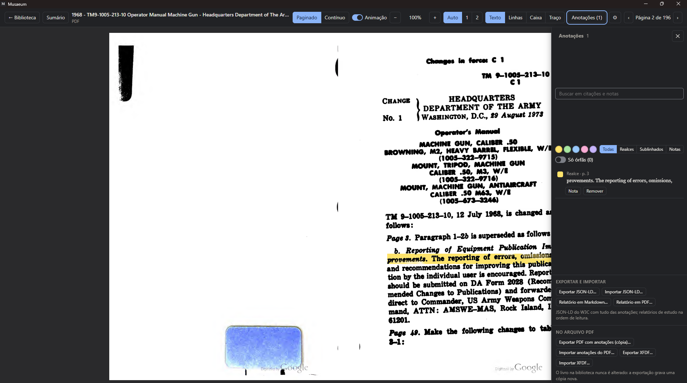
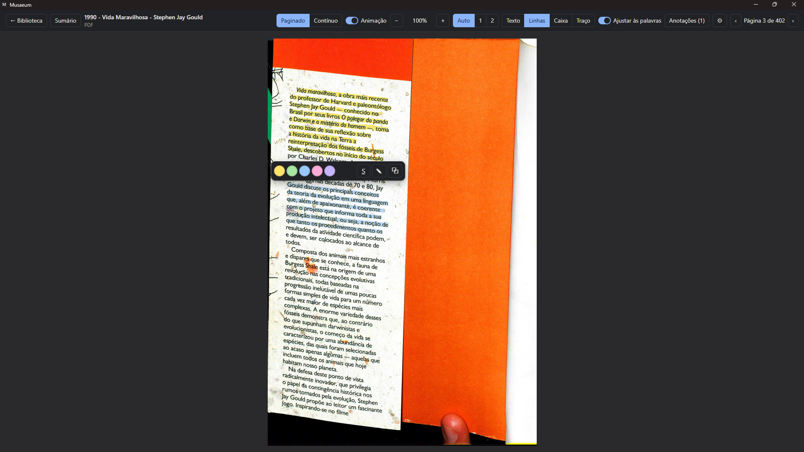

# Musaeum

*[Read in English](README.md)*

Leitor de livros digitais e gerenciador de biblioteca livre e de código aberto (`GPL-3.0-or-later`).


**Versão 1.2.0**, para Windows 10 e 11 (x64). O histórico de versões está em
[`CHANGELOG.md`](CHANGELOG.md), e as instruções de compilação, verificação e assinatura de código estão
em [`docs/release.md`](docs/release.md).

<p align="center">
  
  
  <br>
  <em>Leitura digital de alta fidelidade e anotações (esquerda); detecção de linhas curvas e OCR Tesseract sob demanda em páginas escaneadas (direita)</em>
</p>

## Instalação

Baixe `Musaeum_1.2.0_x64-setup.exe` e execute-o: a instalação é por usuário, sem exigir privilégios de
administrador, em português do Brasil ou inglês. Para implantações multiusuário, também há instaladores
MSI para toda a máquina (`Musaeum_1.2.0_x64_pt-BR.msi` ou `..._en-US.msi`). Nada mais é necessário: o
WebView2 já vem integrado ao Windows 11 (em máquinas sem ele, o instalador baixa da Microsoft), e o
runtime do Visual C++ é vinculado estaticamente em todos os executáveis. Atualizar por cima do mesmo
formato de pacote preserva todos os dados, e desinstalar remove apenas o programa—nunca sua biblioteca,
suas anotações ou suas preferências.

Os instaladores desta versão ainda não possuem assinatura digital de código, portanto o Windows
SmartScreen pode exibir um aviso de editor desconhecido. Sempre verifique a soma SHA-256 do arquivo
baixado comparando-a ao hash publicado (`Get-FileHash <arquivo> -Algorithm SHA256`).

## O que o Musaeum Garante

- **Seus livros são estritamente somente leitura.** O Musaeum nunca grava nada dentro de nenhuma pasta de
  livros acompanhada—nem banco de dados, nem cache, nem exportações, nem relatórios de estudo, nem cópias
  anotadas de PDF. A biblioteca, o cache e as preferências ficam em `%LOCALAPPDATA%\Musaeum` (ou no
  diretório informado via `--library`), e o aplicativo recusa acompanhar qualquer pasta que contenha
  esses arquivos. Um arquivo em disco só muda por comando explícito do usuário na CLI (`musaeum move`),
  protegido por diário de operações e suporte a desfazer.
- **Nada se perde silenciosamente.** Um arquivo ausente permanece marcado como ausente com todos os dados
  vinculados intactos; uma anotação cujo trecho não pode mais ser localizado torna-se órfã e continua
  listada, nunca excluída; gatilhos no banco de dados bloqueiam exclusões que causariam perda de dados.
- **Todo arquivo de livro é tratado como entrada hostil.** Cada formato é analisado e renderizado em um
  processo worker isolado com token restrito de baixa integridade, mitigações de processo, job object
  dedicado e estação de janela separada: sem rede, sem abertura de arquivos por caminho e sem criação de
  processos filhos. Os workers de quadrinhos, DjVu, OCR e ingestão também bloqueiam `win32k` e aceitam
  apenas DLLs assinadas pela Microsoft. Tanto testes automatizados quanto o aplicativo instalado verificam
  isso externamente (`tools/sandbox-audit`). Livros fluidos são normalizados antes da exibição, têm
  scripts removidos e são renderizados em uma origem única por livro sem acesso aos comandos IPC do
  aplicativo.
- **Offline por projeto.** O aplicativo não faz requisições de rede. Pacotes opcionais de idioma de OCR
  são baixados separadamente por script e só são carregados após verificação SHA-256.

## O que Existe Hoje

O projeto concluiu seu Plano Mestre até a Fase 8 (`v1.0.0`)—cobrindo o **marco Alpha** (biblioteca de uso
diário com leitor integrado), Fase 4 de anotações em texto, Fase 5 de suporte a livros escaneados, o
**marco Beta** (organização completa da biblioteca na Fase 6), Fase 7 de portabilidade de anotações e
Fase 8 de preferências, localização, acessibilidade e endurecimento de lançamento—seguido pelas versões
pós-1.0 com polimento visual da biblioteca, barra de título nativa customizada no Windows (`v1.1.0`) e
abas de múltiplos livros estilo Acrobat com suspensão determinística de sessões WebGL2 (`v1.2.0`). Os
recursos incluem:

- **Biblioteca e Organização:** Acompanha pastas escolhidas (com seleção múltipla nativa do Windows via
  `FOS_ALLOWMULTISELECT`) e exibe livros em grade de capas de tamanho fixo (ajustável por `Ctrl + Scroll`
  ou Preferências entre `120` e `260 px`, padrão `168 px`) ou lista, com scrollbars de overlay com
  amortecimento exponencial (*zero layout shift*), busca instantânea por título e busca textual completa
  em segundo plano (mostrando trechos destacados, página/seção e salto direto ao resultado). Conta com
  barra lateral redimensionável e persistente (`180–420 px`, recolhível com `Ctrl+B`) que oculta
  automaticamente seções de taxonomia vazias e filtra por pasta em disco, árvores de categorias de até 16
  níveis, etiquetas, coleções com ordenação manual e coleções inteligentes (regras como *"autor contém
  Sagan e ano entre 1980 e 1999"*).
- **Abas de Múltiplos Livros e Barra Nativa Win32:** Faixa unificada de abas de `40 px` estilo Adobe
  Acrobat integrada à barra de título customizada via subclassing Win32 (`WM_NCCALCSIZE`,
  `DwmExtendFrameIntoClientArea` com compensação por DPI ao maximizar), preservando Aero Snap,
  redimensionamento pelas bordas, `Win + Setas`, `Win + Z`, Lei de Fitts no botão fechar maximizado e
  ocultação em tela cheia (`F11`). Inclui botão rápido de Preferências (`⚙`), aba fixa Casa (`🏠`)
  preservando o estado virtualizado da biblioteca em `0 ms`, abas de livros sem duplicação com fechamento
  pelo botão do meio e espaçador de arrasto garantido, atalhos globais de abas (`Ctrl+Tab`,
  `Ctrl+Shift+Tab`, `Ctrl+W`/`Ctrl+F4`, `Ctrl+1`–`9` inclusive dentro de iframes fluidos), snapshots
  completos por aba (`ReaderTabSnapshot`) e suspensão determinística de GPU/SHM/workers garantindo teto
  rígido de no máximo `1` sessão de renderização ativa (`0` na aba Casa).
- **Metadados, Edição em Lote, Deduplicação e Calibre:** O painel de Detalhes edita título, pessoas e
  papéis, série, ano, idioma, identificadores, nota, status de leitura, sinopse e campos personalizados
  para um único livro ou vários selecionados ao mesmo tempo, usando proveniência por campo para que novas
  leituras de arquivos nunca sobrescrevam edições do usuário. Inclui tela de Revisão para reconciliar
  arquivos/obras duplicadas e mesclá-las sem perder anotações ou taxonomia, além de importação
  estritamente somente leitura de bibliotecas Calibre (`metadata.db` / `metadata.opf`).
- **Leitores Fluido e de Página Fixa:** Leitor fluido para EPUB 2/3, MOBI, AZW3, FB2, TXT e Markdown
  (normalizados em worker isolado) com modo paginado com animações de virada ou rolagem contínua
  customizada, controles tipográficos e temas; leitor de página fixa para PDF, quadrinhos (CBZ/CBR) e
  DjVu; barra unificada, sumário, atalhos e persistência exata da posição de leitura entre sessões e abas.
- **Anotações e Livros Escaneados (OCR):** Realces, sublinhados e notas em Markdown em livros fixos e
  fluidos com reancoragem por âncora tripla entre renomeações, movimentações e novas edições, apoiados
  pelo Inspetor de Anotações pesquisável. Em páginas escaneadas, a detecção de linhas em segundo plano
  localiza linhas retas, curvadas na lombada e rotacionadas (45° / 90°) para seleção magnética por linha,
  caixas translúcidas e traços livres de tinta, enquanto o OCR Tesseract isolado extrai texto para cópia e
  busca textual completa.
- **Portabilidade e Relatórios de Estudo:** Exportação/importação de anotações nativas em PDF compatíveis
  com Acrobat e PDFium (sempre em uma nova cópia), XFDF estrito anti-XXE, JSON-LD W3C Web Annotation sem
  perdas (livro único, seleção ou biblioteca inteira) e relatórios de estudo determinísticos em Markdown e
  PDF A4 ordenados por posição de leitura e capítulos.
- **Preferências, Localização e Acessibilidade:** Interface e backend totalmente localizados em português
  do Brasil (`pt-BR`) e inglês (`en`), temas sistema/claro/escuro (incluindo a barra de título nativa
  customizada), suporte a `prefers-reduced-motion`, nome configurável do autor das anotações, seleção
  verificada de idiomas de OCR, limpeza segura de cache, navegação por teclado, gerenciamento de foco e
  contraste WCAG AA verificado por testes.

As decisões arquiteturais e medições das Fases 0–8 estão documentadas em
[`docs/adr/0001-fase-0.md`](docs/adr/0001-fase-0.md) até
[`docs/adr/0015-fase-8-parte-2-release-1-0.md`](docs/adr/0015-fase-8-parte-2-release-1-0.md), e as
mudanças pós-1.0 estão registradas em [`CHANGELOG.md`](CHANGELOG.md).

Atualmente, o Musaeum compila e executa apenas no **Windows**.

## Arquitetura

```text
 musaeum-desktop.exe (Tauri 2)                       processos isolados, um por tarefa
 ┌──────────────────────────────────────────┐        ┌──────────────────────────────────────┐
 │ WebView2: UI (React, React Aria),        │        │ musaeum-render-pdf      PDFium       │
 │ compositor WebGL2 em Web Worker,         │  tiles │ musaeum-pdf-annots      PDFium       │
 │ e cada livro fluido em sua própria       │◄──────►│ musaeum-render-raster   libarchive   │
 │ origem, sem acesso a IPC                 │  shm   │ musaeum-render-djvu     DjVuLibre    │
 ├──────────────────────────────────────────┤ + pipe │ musaeum-ocr             Tesseract    │
 │ Host Rust: barra Win32, comandos         │        │ musaeum-ingest          metadados,   │
 │ validando cada página, biblioteca        │        │                         normalizador │
 │ (SQLite, Tantivy), tiles e cache         │        └──────────────────────────────────────┘
 └──────────────────────────────────────────┘          token restrito, baixa integridade,
                                                       job object, mitigações, sem rede
```

Somente o host Rust abre arquivos: ele repassa a cada worker um handle somente leitura do livro (ou bytes
brutos por pipe) e trata toda resposta do worker como não confiável. O frontend conversa com o host
exclusivamente via comandos IPC validados; não consegue informar caminhos arbitrários para leitura ou
escrita (caminhos vêm de diálogos do sistema), e suas permissões Tauri restringem-se a ouvintes de
eventos. As abas de múltiplos livros mantêm a invariante estrita de sessão única ativa: trocar de aba ou
voltar para Casa descarta deterministicamente o compositor WebGL2 ativo, libera os mapeamentos
`ICoreWebView2SharedBuffer` escopados à sessão e encerra workers ociosos, mantendo apenas um
`ReaderTabSnapshot` leve em memória. Os crates centrais (`crates/`) não dependem do Tauri e são
compartilhados diretamente com a CLI.

## Estrutura do Repositório

```text
crates/
  musaeum-shm/         Protocolo de memória compartilhada: pixel slab, anel de entrega, mensagens
                       de controle, views de seção NT duplicadas e aritmética de tiles
  musaeum-core/        Escalonador puro em máquina de estados e supervisor de workers (sem Tauri)
  musaeum-sandbox/     Token restrito, mitigações de processo, job object, estação de janela isolada
  musaeum-worker/      Runtime compartilhado dos workers de renderização: handshake, handles, laço
                       de controle, cancelamento e harness de testes
  musaeum-render-pdf/  Rasterizador isolado de tiles PDFium e worker de anotações PDF
                       (musaeum-pdf-annots.exe)
  musaeum-pdf-annot/   Parser nativo de anotações PDF, escritor incremental em cópia, parser e
                       serializador XFDF estrito e RPC do worker
  musaeum-report/      Relatórios de estudo: ordenação por leitura/capítulo, parser de notas em
                       Markdown, exportador Markdown e gerador nativo de PDF com fontes Noto
  musaeum-archive/     libarchive embutido (suporte somente leitura a ZIP, RAR e RAR5)
  musaeum-render-raster/  Renderizador isolado de quadrinhos (CBZ, CBR)
  musaeum-djvu/        DjVuLibre embutido atrás de ponte C++
  musaeum-render-djvu/ Renderizador isolado de DjVu
  musaeum-fs/          File IDs de 128 bits, listagem sem abrir arquivos, recusa de placeholders em
                       nuvem e observador de sistema de arquivos ciente de overflow
  musaeum-flow/        Normalizador de livros fluidos em Rust seguro e motor de localizadores
                       (CFI & Locator): DOM, XML/HTML5, sanitizador, CSS, chunking e leitores
                       EPUB/MOBI/KF8/FB2/TXT/MD
  musaeum-ingest/      Worker isolado para extração de metadados, flags de catálogo PDF
                       (`/PageLayout`, `/Direction`) e normalização fluida
  musaeum-library/     Persistência SQLite, identidade de arquivo, indexador, diário de operações,
                       posições de leitura, geometria de páginas, anotações W3C e reancoragem,
                       intercâmbio JSON-LD, cache de livros normalizados e modelos de linhas
  musaeum-vision/      Detector de linhas em páginas escaneadas: binarização Sauvola, componentes
                       conectados, inclinação, colunas em faixas, polilinhas de linha de base,
                       texto rotacionado, máscara de fotos/gráficos/tabelas, hash perceptual e
                       corpus rotulado de testes
  musaeum-tesseract/   Tesseract e Leptonica compilados a partir do código-fonte via ponte C++
  musaeum-ocr-worker/  Worker isolado Tesseract lendo uma linha retificada por vez
  musaeum-ocr/         Protocolo do host para OCR e retificação de linhas pela linha de base
apps/cli/              Binário `musaeum`: acesso completo à biblioteca pela linha de comando
apps/desktop/
  src-tauri/           Ponte Tauri: barra de título Win32 (`titlebar.rs`), protocolos `tile://`,
                       `book://` e `thumb://`, ciclo de vida de sessões e `CloseGuard`, host da
                       biblioteca/índice, miniaturas, livros normalizados, buffers WebView2 e testes
  src/app/             UI da biblioteca, abas múltiplas (`tabs-model.ts`, `TitleBar.tsx`),
                       scrollbar exponencial de overlay e UI do leitor (React + React Aria)
  src/fixed/           Controlador da thread principal do leitor fixo e trava serializada de sessão
  src/                 Compositor WebGL2 em Web Worker: modos de leitura, spreads, física de
                       virada de página, descarte determinístico de GPU e cache de tiles
  src/reader/          Leitor fluido em origem isolada: visão paginada (foliate-js adaptado),
                       rolagem contínua customizada, ancoragem, repasse de atalhos e tipografia
vendor/
  foliate-js/          Commit fixado do foliate-js com patch documentado
  libarchive/          libarchive 3.8.11 (lado leitura), origem e config.h documentados
  djvulibre/           DjVuLibre 3.5.30 (`libdjvu`)
  tesseract/           Tesseract 5.5.4, Leptonica 1.87.0 e modelos `por`/`eng` (baixados via
                       `fetch-ocr.ps1`; apenas o README fica versionado)
  fonts/               Noto Sans, Serif, Sans Mono, Sans Math e Sans Symbols 2 para relatórios PDF
                       (baixadas via `fetch-fonts.ps1`)
  third-party.json     Metadados de licenças para dependências embutidas fora de gerenciadores
tools/
  fetch-pdfium.ps1     Baixa build fixado do PDFium e verifica SHA-256
  fetch-ocr.ps1        Baixa versões fixadas de Tesseract, Leptonica e modelos tessdata com SHA-256
  fetch-fonts.ps1      Baixa fontes Noto fixadas para relatórios PDF com SHA-256
  gen-fixtures/        Gera PDFs de teste, quadrinhos, DjVu, EPUBs, EPUB hostil e livro multiformato
  pool-bench/          Benchmark headless do pool de renderização
  library-bench/       Benchmark de busca por tecla em biblioteca de 100.000 arquivos
  corpus-check/        Validação somente leitura de biblioteca, pipeline, normalizador, linhas e PDF
  cfi-browser-check.mjs  Valida CFIs EPUB gerados no Chrome com foliate-js
  visual-check/        Diferença visual janela-vs-referência e verificação de cores via PDFium
  e2e-reader.mjs       Teste E2E do leitor em janela real: modos, atalhos, posição e diff visual
  e2e-alpha.mjs        Suíte Alpha em janela real: biblioteca, leitor e posições entre formatos
  e2e-taxonomy.mjs     Suíte de taxonomia da biblioteca e painel de detalhes em janela real
  e2e-beta.mjs         Suíte Beta em janela real: edição em lote, revisão/mesclagem, busca, Calibre
  e2e-pdf-annotations.mjs  Suíte em janela real de exportação/importação PDF nativa e XFDF
  e2e-exchange.mjs     Suíte em janela real de ida e volta JSON-LD W3C e relatórios de estudo
  e2e-preferences.mjs  Suíte em janela real de Preferências, i18n, temas, movimento reduzido e foco
  e2e-ipc.mjs          Sonda hostil de IPC/ACL contra o aplicativo rodando sem `--e2e`
  sandbox-audit/       Auditor externo em nível de kernel para processos workers em execução
  stage-bundle.mjs     Prepara artefatos do instalador e rejeita binários que importem runtime VC++
  smoke-bundle.mjs     Instala, executa, audita e desinstala os instaladores fora do repositório
  third-party-notices.mjs  Gera `THIRD-PARTY-NOTICES.md` a partir dos lockfiles e metadados vendor
  reader-check.mjs     Teste em Chrome headless do leitor fluido sobre livros normalizados
  lib/cdp.mjs          Driver WebView2 CDP para suítes E2E em janela real
  lib/clipboard.mjs    Helper de área de transferência preservando/restaurando o clipboard nos testes
  lib/seam-oracle.mjs  Oráculo de emenda de chunks para capítulos fluidos longos
  lib/calibre-library.mjs  Gerador sintético de biblioteca Calibre (`lib/calibre-schema.sql`)
  run-bench.mjs        Executa a matriz de benchmarks dos Experimentos A e B
  run-epub-bench.mjs   Mede latência de relayout do leitor fluido
  measure-memory.mjs   Mede uso de RAM da aplicação completa
  test-cascade.mjs     Testa a cascata automática de entrega de pixels no aplicativo real
  test-epub-security.mjs  Testa cada barreira de isolamento fluido independentemente em EPUB hostil
  check-licenses.mjs   Verifica licenças de dependências e atualização de `THIRD-PARTY-NOTICES.md`
docs/
  adr/                 Architecture Decision Records e medições das Fases 0–8
  release.md           Guia de compilação, auditoria, empacotamento e assinatura
```

## Compilação e Execução

Pré-requisitos: Rust (versão fixada em `rust-toolchain.toml`), Visual Studio Build Tools com C++ e
Windows SDK, Node.js 24, `cargo-deny` (`cargo install cargo-deny`) e runtime WebView2 (incluído no
Windows 11). O runtime C/C++ é vinculado estaticamente em todos os executáveis (`.cargo/config.toml`).

```powershell
powershell -ExecutionPolicy Bypass -File tools\fetch-pdfium.ps1
powershell -ExecutionPolicy Bypass -File tools\fetch-ocr.ps1
powershell -ExecutionPolicy Bypass -File tools\fetch-fonts.ps1

cd apps\desktop
npm ci
npm run build:app
cd ..\..

.\target\release\gen-fixtures.exe --out fixtures
```

`npm run build:app` compila o aplicativo desktop e os workers em `target\release`; `npm run build:bundle`
também gera os instaladores Windows em `target\release\bundle` ([`docs/release.md`](docs/release.md)).

Iniciando o aplicativo:

```powershell
.\target\release\musaeum-desktop.exe
.\target\release\musaeum-desktop.exe --library D:\MinhaBiblioteca
```

Quando ainda não existe biblioteca, o aplicativo pede uma ou mais pastas de livros ou um diretório de
biblioteca existente. Ele guarda o banco em `%LOCALAPPDATA%\Musaeum` (ou no caminho passado em
`--library`) e nunca escreve dentro das suas pastas de livros. Um clique seleciona um livro e abre seus
detalhes; duplo clique ou `Enter` abre o livro em uma aba (ou foca a aba existente); `← Biblioteca` (ou
`Alt+←`) volta à aba fixa Casa (`🏠`) mantendo a aba do livro aberta. Use `Ctrl+Tab` / `Ctrl+Shift+Tab`
para alternar entre abas, `Ctrl+W` / `Ctrl+F4` ou clique do botão do meio para fechar a aba de livro
ativa, `Ctrl+1`–`9` para ir direto por índice (`Ctrl+1` = Casa), `Ctrl+B` para recolher a barra lateral,
`Ctrl+Scroll` sobre a grade para ajustar o tamanho das capas e `F11` para tela cheia. No leitor, `C`
alterna modo paginado/contínuo, `A` alterna animações de virada, `Aa` abre controles tipográficos fluidos
e `Sumário` abre o sumário.

Para anotar, selecione texto arrastando, com duplo clique em uma palavra, triplo clique em uma linha ou
clique quádruplo em um parágrafo (página fixa); seleções cruzam quebras de página e emendas de chunks em
capítulos longos. Uma barra flutuante oferece cinco cores de realce, sublinhado, notas em Markdown com
pré-visualização e cópia; clicar em uma marca existente abre a mesma barra com exclusão (e desfazer).
`Anotações` abre o Inspetor para filtrar por cor, tipo ou status de órfã, buscar sem distinção de acentos
entre trechos e notas e saltar direto para a passagem.

Abrindo um documento diretamente (pulando a interface da biblioteca):

```powershell
.\target\release\musaeum-desktop.exe --document fixtures\spreads.pdf
.\target\release\musaeum-desktop.exe --document fixtures\comic.cbz
.\target\release\musaeum-desktop.exe --document fixtures\book.djvu
.\target\release\musaeum-desktop.exe --document D:\Livros\exemplo.pdf --library D:\MinhaBiblioteca
.\target\release\musaeum-desktop.exe --epub fixtures\large.epub
```

`--document` detecta PDF, CBZ, CBR ou DjVu pelos magic bytes e não pela extensão (`--pdf` continua como
atalho). A navegação usa setas, Page Up/Down, Espaço, Home e End; `Ctrl` com `+`, `-`, `0`, rodinha do
mouse ou pinça aplica zoom ao redor do cursor. `--tile-budget-mb N` limita a memória de GPU para tiles.

Executando benchmarks (execute em máquina ociosa; os resultados são gravados em `bench-results/`):

```powershell
node tools\run-bench.mjs
node tools\run-bench.mjs --scenario quick --uncapped --stress 0
.\target\release\musaeum-desktop.exe --pdf exemplo.pdf --bench zoom.json --scenario zoom
node tools\run-epub-bench.mjs
node tools\measure-memory.mjs
```

## Interface de Linha de Comando (`musaeum`)

```powershell
cargo build --release -p musaeum-cli -p musaeum-library

.\target\release\musaeum.exe root add D:\Livros
.\target\release\musaeum.exe reconcile
.\target\release\musaeum.exe status
.\target\release\musaeum.exe search dostoievski
.\target\release\musaeum.exe search "dom casmurro" --keystrokes
.\target\release\musaeum.exe inspect D:\Livros\exemplo.pdf
.\target\release\musaeum.exe revisions D:\Livros\exemplo.pdf
.\target\release\musaeum.exe suggestions
.\target\release\musaeum.exe move D:\Livros\a.pdf D:\Livros\b.pdf
.\target\release\musaeum.exe undo
.\target\release\musaeum.exe watch
```

Execute `musaeum --help` para a lista completa de comandos e passe `--json` antes de qualquer subcomando
para saída legível por máquina. Consultas somente leitura funcionam concorrentemente enquanto
`musaeum watch` está em execução.

Três invariantes regem o núcleo da biblioteca:

1. **O disco é a fonte da verdade.** Eventos do sistema de arquivos são apenas pistas de onde olhar
   primeiro; eventos perdidos custam latência, nunca dados. A mesma lógica de reconciliação cobre
   varreduras iniciais, observação ao vivo e alterações offline.
2. **Nada é excluído automaticamente.** Arquivos ausentes permanecem marcados como ausentes com todos os
   metadados e anotações preservados. Gatilhos no banco impedem excluir revisões confirmadas ou
   anotações, e mutações em disco só ocorrem por comandos explícitos com diário e desfazer.
3. **Parsers permanecem em sandbox.** Ler `/ID[0]` ou `dc:identifier` significa analisar bytes não
   confiáveis; por isso, `musaeum-ingest` roda sem rede e sem acesso por caminho, recebendo cada livro
   por handle somente leitura duplicado.

## Organização da Biblioteca

- **Navegação na barra lateral:** Redimensionável (`180–420 px`, duplo clique no divisor restaura
  `240 px`, `Ctrl+B` recolhe) com *Todos os livros*, *Pastas* em disco (com gerenciamento de múltiplas
  pastas e omissão visual de pasta raiz única com subpastas), *Categorias* (até 16 níveis aninhados),
  *Etiquetas*, *Coleções* e *Coleções inteligentes*. Seções de taxonomia vazias ocultam-se
  automaticamente (expansíveis em `+ Organizar`), a contagem de livros é opcional (desligada por padrão),
  selecionar uma categoria inclui suas subcategorias e coleções preservam ordenação manual. Cada item tem
  menu `⋯` (renomear, mover, reordenar, excluir) e cada seção tem ação `+`.
- **Coleções inteligentes:** Construtor de regras sobre 16 campos padrão mais campos personalizados com
  correspondência "todas" / "qualquer", sem distinção de maiúsculas ou acentos, exibindo contagem ao vivo
  durante a edição.
- **Painel de Detalhes:** Um clique seleciona um livro e abre seus detalhes com transição lateral suave;
  duplo clique ou `Enter` o abre. Cada campo indica sua proveniência (*"do arquivo"*, *"do Calibre"*,
  *"editado"*). Edições do usuário nunca são sobrescritas por revarreduras ou importações futuras. ISBNs
  validam o dígito verificador.
- **Campos personalizados:** Definidos uma vez (*Campos personalizados…*) como texto, número, data,
  booleano, enumeração ou URL.
- **Seleção múltipla e edição em lote:** `Ctrl+clique`, `Shift+clique` e `Ctrl+A` (buscando todos os IDs
  correspondentes no host, mesmo além da área virtualizada) alternam o painel para edição atômica em lote
  de pessoas, série, ano, idioma, nota, status, categorias, etiquetas e coleções.
- **Revisão e mesclagem:** Lista sugestões de reconciliação e possíveis obras duplicadas (identificador
  compartilhado ou título + autor principal compatíveis). Pares rejeitados não reaparecem; mesclar move
  todos os documentos, anotações, posições de leitura e taxonomia para a obra escolhida (sincronizando ou
  fechando automaticamente abas afetadas).
- **Busca textual completa:** Alterne *Títulos / No texto* (baseada em Tantivy 0.27) para consultas de
  todas as palavras e frases entre aspas sobre camadas de texto de PDF/DjVu, linhas escaneadas lidas por
  OCR e livros fluidos, indexados em segundo plano sob orçamento estrito de CPU. Clicar em um resultado
  abre o livro na página ou seção exata, e voltar preserva o estado da busca.
- **Importação do Calibre:** *Importar do Calibre…* abre `metadata.db` como arquivo imutável (recusando
  importação durante escritas ativas do Calibre, com fallback para `metadata.opf`), importando formatos,
  metadados, séries, etiquetas, notas, identificadores, comentários sem HTML e colunas personalizadas sem
  alterar um único byte na pasta do Calibre, deduplicando arquivos existentes por BLAKE3.

## Leitor de Página Fixa e Livros Escaneados

- **Tiling em escala exata:** Tiles são rasterizados na escala exata de exibição (passos de 1/4096 px/pt)
  em vez de potências de dois, reamostrados suavemente durante animações de zoom enquanto os tiles finais
  chegam antes do término da animação.
- **Geometria sem rasterização e spreads:** Dimensões das páginas e `/PageLayout` são extraídos sem
  rasterizar e guardados em `cache.db` por hash BLAKE3. Spreads preservam paridade impressa, isolam
  páginas em paisagem e respeitam `/PageLayout` e direção RTL.
- **Workers autorrecuperáveis:** Workers encerrados ou travados são reiniciados em dezenas de
  milissegundos; tiles que derrubam workers duas vezes entram em quarentena.
- **Pipeline unificado multiformato:** PDF (PDFium), quadrinhos (libarchive + decodificadores Rust) e
  DjVu (DjVuLibre) compartilham o mesmo protocolo de worker. Os workers de quadrinhos e DjVu são
  vinculados estaticamente e rodam sob o sandbox mais restrito `LockdownParser` (sem `win32k`, apenas
  DLLs assinadas pela Microsoft).
- **Classificação de página e detecção de linhas escaneadas:** Páginas são classificadas em segundo plano
  como texto digital, imagem escaneada ou híbrida. Páginas escaneadas/híbridas são rasterizadas em tons de
  cinza a 1.500 px e analisadas em ~20 ms (`musaeum-vision`) para localizar linhas retas, curvadas na
  lombada e rotacionadas (45° / 90°), rejeitando fotos, meios-tons, gráficos, grades de tabela,
  sublinhados a lápis e rabiscos de margem. O modo *Linhas* adere palavra a palavra pelas polilinhas;
  *Caixa* e *Tinta* marcam regiões arbitrárias.
- **OCR isolado sob demanda:** Criar uma marca com *Linhas*, *Caixa* ou *Tinta* retifica cada linha
  subjacente pela sua linha de base e executa o Tesseract 5.5.4 dentro de `musaeum-ocr.exe` (mesmo
  sandbox restrito). O texto extraído habilita cópia nativa (`Ctrl+C`), preenche citações das anotações,
  persiste em `cache.db` (`ocr_line`) e alimenta o índice de busca textual completa.
- **Miniaturas em segundo plano:** Geradas na menor prioridade do escalonador em
  `cache\thumbnails\v1\ab\<hash>\<página>.jpg` (até 256 px), interrompidas imediatamente sempre que um
  tile visível precisa de worker.

## Anotações Nativas em PDF e XFDF

Dentro do painel *Anotações* de um PDF, a seção *No arquivo PDF* oferece quatro ações:

- **Exportar PDF com anotações (cópia)…** grava uma nova cópia contendo os bytes originais do livro
  intactos seguidos por uma atualização incremental PDF com anotações compatíveis com Acrobat e PDFium
  (`/Highlight`, `/Underline`, `/Square`, `/Ink`, `/Text`), `/QuadPoints`, `/Contents` em UTF-16BE, cores,
  datas, autor (`/T`), streams de aparência (`/AP`) e `/NM` estável derivado do `UUIDv7` da anotação.
  Antes de renomear no destino, o PDFium verifica cada anotação e todos os objetos pré-existentes. Os
  arquivos originais da biblioteca nunca são modificados.
- **Importar anotações de PDF…** importa anotações nativas do próprio livro ou de uma cópia anotada
  externamente de forma idempotente via `/NM`.
- **Exportar XFDF…** e **Importar XFDF…** trocam arquivos XFDF do Acrobat usando um parser estrito
  anti-XXE que rejeita `<!DOCTYPE>`, instruções de processamento e entidades externas.

Toda análise de PDF e XFDF roda dentro de `musaeum-pdf-annots.exe` sob o sandbox de renderização PDF.
PDFs criptografados suportam importação, mas não exportação incremental (`ADR 0012`).

```powershell
node tools\e2e-pdf-annotations.mjs
target\release\corpus-check.exe --pdf-annots --corpus D:\Livros --work D:\work --out D:\work\report.json
```

## Intercâmbio W3C JSON-LD e Relatórios de Estudo

Acessível pelo painel *Anotações* do leitor, pelos detalhes de um ou vários livros e pelo menu
*Anotações* da biblioteca:

- **Exportar / Importar JSON-LD…** troca arquivos W3C Web Annotation `AnnotationCollection` sem perdas
  entre todos os formatos suportados, preservando `UUIDv7`, notas em Markdown, cores, citações e todos os
  seletores (`TextQuoteSelector`, `TextPositionSelector`, `RangeSelector` com CFIs EPUB, regiões
  página/UV e hashes perceptuais de 64 bits) ancorados em `urn:blake3:…`. O importador estrito valida
  limites (256 MB, 16 níveis de aninhamento, sem `@context` remoto, sem chaves duplicadas) em transação
  única, deduplica por `UUIDv7` e reancora automaticamente anotações em outras edições (`exata`,
  `aproximada` ou `órfã`).
- **Relatórios de Estudo em Markdown e PDF…** geram cadernos de estudo na ordem de leitura agrupados
  pelos capítulos do sumário, com anotações órfãs ao final. A saída Markdown mira Obsidian, Notion e Git;
  o PDF A4 é gerado nativamente com subconjuntos das fontes Noto (`ToUnicode`), texto Unicode
  selecionável, barras de realce coloridas, cabeçalhos/rodapés e marcadores de capítulo—produzindo bytes
  determinísticos e verificados via PDFium antes de renomeação atômica (`ADR 0013`).

```powershell
node tools\e2e-exchange.mjs
```

## Preferências e Localização

Abra **Preferências** pelo botão `⚙` na barra superior da janela, pelo botão `⚙` no leitor ou pressionando
**`Ctrl+,`** de qualquer lugar. Todas as alterações têm efeito imediato sem reiniciar:

- **Idioma da interface:** Português do Brasil (`pt-BR`) ou inglês (`en`), cobrindo integralmente os
  catálogos da interface (`apps/desktop/src/app/i18n/`) e do host/relatórios Rust (`crates/musaeum-i18n/`),
  incluindo diálogos do sistema, controles nativos da janela, recusas, `/Subj` de PDF, assuntos XFDF e
  relatórios de estudo.
- **Tema e movimento reduzido:** Temas sistema, claro ou escuro (incluindo barra de título customizada e
  faixa de abas) construídos sobre tokens CSS com contraste WCAG AA verificado em testes, além de
  `prefers-reduced-motion` e controle manual de movimento reduzido.
- **Layout da biblioteca:** Largura das capas (`120–260 px`, também ajustável via `Ctrl + Scroll` sobre a
  grade) e contagem opcional de livros na barra lateral (desligada por padrão).
- **Autor das anotações:** Gravado em `/T` no PDF, `title` no XFDF e cabeçalhos dos relatórios de estudo
  (usando o usuário do Windows em PDF/XFDF quando deixado em branco).
- **Idiomas de OCR:** Escolha de 1 a 4 modelos verificados `tessdata_fast` (`por` e `eng` já incluídos;
  `spa`, `fra`, `deu`, `ita` e `lat` disponíveis via `tools\fetch-ocr.ps1 -Languages spa,fra` com hashes
  SHA-256 fixados e validados pelo host antes do envio ao worker de OCR em sandbox).
- **Diagnóstico e limpeza de cache:** Exibe o espaço ocupado em disco por modelos de linhas, OCR, índice
  textual completo, livros fluidos normalizados e miniaturas, com limpeza segura dos caches de linhas/OCR
  sem tocar nos dados da biblioteca ou nas anotações.

As preferências ficam em `%LOCALAPPDATA%\Musaeum\preferences.db` (ou ao lado de `--library`), criado
apenas na primeira alteração (`ADR 0014`).

```powershell
node tools\e2e-preferences.mjs
```

## Validação em Corpus Real e E2E em Janela Real

```powershell
# Validação somente leitura de corpus (biblioteca, geometria, miniaturas, renderização e queda de workers)
cargo build --release -p corpus-check -p musaeum-render-pdf -p musaeum-library --bins
.\target\release\corpus-check.exe --corpus D:\Livros --work D:\Temp\check --sample 12

# Normalização fluida e verificação de CFI
.\target\release\corpus-check.exe --corpus D:\Livros --work D:\Temp\flow --flow-only
node tools\cfi-browser-check.mjs --cache D:\Temp\flow\cache
node tools\reader-check.mjs --cache D:\Temp\flow\cache

# Detecção de linhas escaneadas e OCR
.\target\release\corpus-check.exe --lines --corpus D:\Livros --work D:\Temp\lines --sample 60 --out lines.json
.\target\release\corpus-check.exe --lines-synthetic --pages 30 --out synthetic.json
.\target\release\corpus-check.exe --ocr-book --work D:\Temp\ocr --out ocr.json
```

Todas as ferramentas de corpus tiram instantâneos de tamanhos, datas e atributos antes e depois e falham
se um único byte mudar em `--corpus`.

## Caminhos de Entrega de Pixels

Três caminhos transferem os tiles renderizados ao compositor WebGL2:

| Caminho | Como os tiles chegam ao Worker | Depende da thread principal? |
|---|---|---|
| A | `fetch` pelo protocolo `tile://` | Não |
| B | Thread principal copia de SharedBuffer para um anel SharedArrayBuffer | Sim |
| C | Worker recebe SharedBuffers transferidos e lê diretamente no local | Não |

Como o Caminho C depende de comportamento não documentado do WebView2 (tempo de vida de `ArrayBuffer`
transferido para um Worker), a inicialização sonda pequenos buffers (`src/probe.ts`) e seleciona o caminho
mais rápido funcional (`C → B → A`, substituível via `--delivery a|b|c`).

## Sandbox dos Renderizadores e Isolamento Fluido

Todo processo worker inicia com token restrito (sem grupos utilizáveis, baixa integridade), mitigações de
processo, job object e estação de janela isolada. Após carregar o PDFium (quando aplicável), o worker se
tranca antes de ler qualquer mensagem do host, mantendo apenas seu handle duplicado somente leitura do
documento e a memória compartilhada.

Os workers de quadrinhos, DjVu, OCR e ingestão não carregam DLLs de terceiros e aplicam `LockdownParser`
(bloqueando `win32k` e DLLs não assinadas pela Microsoft). Os dois workers PDFium ainda não podem ativar
essas duas mitigações porque o `pdfium.dll` pré-compilado importa `user32`. Cada worker possui auditoria
externa em nível de kernel (`tests/sandbox.rs` via `musaeum_sandbox::ProcessAudit`), e
`tools/sandbox-audit` audita aplicativos instalados em execução:

```powershell
.\target\release\sandbox-audit.exe --under "$env:LOCALAPPDATA\Musaeum"
```

Injetores de processo em nível de sistema no Windows (alguns ganchos de antivírus, Windhawk) podem
injetar brevemente nos dois workers PDFium na criação do processo; os outros quatro workers bloqueiam
essa injeção. Usuários de ferramentas como Windhawk podem adicionar `musaeum-*.exe` à lista de exclusões.

Livros fluidos aplicam quatro camadas independentes de isolamento: (1) normalização estática em Rust
removendo scripts, manipuladores de eventos e requisições externas; (2) CSP com nonce herdada por URLs
`blob:`; (3) iframes de seção em sandbox sem `allow-scripts`; e (4) origens aleatórias por livro
(`http://book.<random>.localhost`) tratadas como remotas pelas ACLs do Tauri.

## Testes

```powershell
cargo fmt --all --check
cargo clippy --workspace --all-targets -- -D warnings
cargo test --workspace
cd apps\desktop; npm test; npx tsc --noEmit; cd ..\..
node --test tools\lib\spdx.test.mjs
node tools\check-licenses.mjs
cargo deny check advisories
```

Suítes E2E em janela real (execute em máquina ociosa—ou informe `--require-idle 0`—após `npm run build:app`
e compilar `musaeum-cli` e `visual-check`):

```powershell
node tools\e2e-preferences.mjs
node tools\e2e-exchange.mjs
node tools\e2e-pdf-annotations.mjs
node tools\e2e-annotations.mjs --phase fixtures
node tools\e2e-annotations.mjs --phase ocr
node tools\e2e-beta.mjs --phase synthetic
node tools\e2e-taxonomy.mjs
node tools\e2e-ipc.mjs
node tools\smoke-bundle.mjs
```

Harnesses adicionais de estresse e segurança: `.\target\release\library-bench.exe` (100.000 arquivos
reais em `%TEMP%`), `node tools\test-cascade.mjs` e `node tools\test-epub-security.mjs`.

## Limitações Conhecidas

- **Somente Windows (10/11, x64).** macOS, Linux, GPUs integradas e monitores de 120 Hz ainda não foram
  medidos. Não há versões móveis nem suporte a livros protegidos por DRM.
- **Workers PDFium ainda permitem `win32k` e DLLs fora da Microsoft.** O `pdfium.dll` pré-compilado
  importa `user32`. Um build estático customizado do PDFium para levar ambos os workers ao
  `LockdownParser` está planejado como marco de segurança pós-1.0.
- **Caminho mais rápido de entrega de pixels** depende de comportamento não documentado de transferência
  no WebView2; a inicialização testa e aplica fallback automaticamente.
- **PDFs criptografados** suportam importação de anotações, mas não exportação incremental. PDFs
  truncados abrem apenas até onde o PDFium consegue reparar.
- **OCR** acompanha português e inglês (`tools\fetch-ocr.ps1` adiciona idiomas extras). Páginas duplas
  escaneadas podem levar ~65 ms na detecção de linhas (acima da meta de 50 ms), e a decodificação de
  imagem (~18 ms) não é cancelável no meio da decodificação.
- **Texto vertical** no espaço de coordenadas do PDF ainda não pode ser selecionado interativamente por
  arrasto.
- **Busca textual completa** normaliza caixa e acentos sem radicalização (*"livro"* não encontra
  *"livros"*) nem segmentação de palavras CJK.
- **Mesclagens de obras e exclusões** de categorias, etiquetas e coleções são irreversíveis (solicitando
  confirmação).
- **Dois idiomas (`pt-BR` / `en`), duas formas de plural;** diagnósticos internos de invariante permanecem
  em inglês por trás de uma mensagem localizada ao usuário.
- **Instaladores sem assinatura digital** (o fluxo de assinatura está documentado em
  [`docs/release.md`](docs/release.md)). A CLI (`musaeum.exe`) é compilada do código-fonte e não acompanha
  o instalador gráfico.

## Metodologia de Desenvolvimento e Transparência de IA

O Musaeum é construído por meio de um **fluxo de engenharia multiagente assistido por IA dirigido por
humano**. O código de produção, o isolamento em sandbox dos workers e as suítes de testes automatizados
são gerados por modelos de IA sob governança arquitetural humana, auditoria fase a fase e QA manual em
uma biblioteca pessoal real.

### Divisão de Responsabilidades

| Papel | Contribuidor | Responsabilidades |
| :--- | :--- | :--- |
| **Criador, Product Owner e Líder de QA** | **Mark Skog** (`@Mark-Skog`) | Visão de produto, requisitos funcionais e garantia de biblioteca somente leitura; decisões finais de arquitetura, UX e segurança em todos os 15 ADRs e versões pós-1.0; QA manual em biblioteca pessoal real (detectando casos reais como páginas escaneadas rotacionadas a 90°, sublinhados a lápis, corridas `0xc0000005` na abertura concorrente de PDFs e regressões de UI); aprovação final de cada versão. |
| **Arquitetura, Especificação e Auditoria** | **Gemini** | Roteiro mestre em fases (Fases 0–8 e blocos pós-1.0), definição de escopo, especificações técnicas, engenharia de prompts e auditoria independente de relatórios de build, falhas E2E, cobertura de testes e compromissos arquiteturais. |
| **Implementação Central (`v1.0.0`)** | **Claude (Opus 5.5 via Claude Code)** | Implementação ponta a ponta em Rust, TypeScript/React, WebGL2 e Tauri 2 até a Fase 8; isolamento de workers em sandbox; automação de testes unitários, integração, IPC e E2E em janela real; empacotamento NSIS/MSI no Windows; autoria dos ADRs. |
| **Implementação Pós-1.0 (`v1.1.0` – `v1.2.0`)** | **Gemini 4 Carbon (via Antigravity)** | Polimento de UI/UX da biblioteca (`v1.1.0`), subclassing da barra de título nativa Win32, correção de *use-after-unmap* em `ICoreWebView2SharedBuffer` (`ShmRegion::from_borrowed_section`), abas múltiplas estilo Acrobat com suspensão determinística de WebGL2/SHM/workers e reidratação de `ReaderTabSnapshot` (`v1.2.0`), e correção de layout `ScrollFrame`/`VisuallyHidden`. |

### Esforço Medido e Verificação

- **Janela Registrada de Desenvolvimento:** `2026-10-31` – `2026-11-28` (`46` commits em `16` dias ativos)
- **Execução Ativa Medida do Agente de Código (`v1.0.0`, logs locais `.jsonl` do Claude Code):**
  **35,2 h – 37,0 h** (usando tetos de 10 min e 30 min por passo, respectivamente) ao longo de
  **3 sessões principais**, **334 turnos de usuário** e **14.286 eventos de assistente/ferramentas**
  (`2026-10-31` – `2026-11-24`)
- **Execução Ativa Medida do Agente de Código (`v1.1.0` – `v1.2.0`, logs locais `transcript_full.jsonl` do Antigravity — Gemini 4 Carbon):**
  **4,5 h – 6,2 h** (usando os mesmos tetos de 10 min e 30 min por passo) ao longo de **2 sessões**,
  **10 turnos explícitos de usuário** e **1.339 eventos de modelo/sistema** (`1.241` de modelo + `98` de
  sistema; `1.349` passos registrados no total, `2026-11-25` – `2026-11-28`)
- **Execução Medida Combinada dos Agentes de Código (`v1.0.0` – `v1.2.0`):** **39,7 h – 43,2 h**
  *(exclui tempo ocioso humano, pausas por limite de taxa, QA manual e sessões de arquitetura/auditoria
  com o Gemini, que não foram cronometradas instrumentalmente)*
- **Portões de Qualidade Verificados na `v1.2.0`:**
  - **866** testes Rust e **279** testes Vitest aprovados (`cargo fmt`, `clippy -D warnings`,
    `tsc --noEmit`, `cargo deny` e `npm audit` limpos; CI verde no GitHub Actions)
  - Suítes E2E em janela real verificadas (`9/9` suítes incluindo teste de instalação limpa, auditoria de
    sandbox e desinstalação em 52 etapas na `v1.0.0`; `e2e-preferences`, `e2e-exchange` e `e2e-ipc` — 36
    checagens hostis de ACL IPC — revalidadas contra os binários de release da `v1.2.0`)
  - **15** Architecture Decision Records (`docs/adr/0001` – `docs/adr/0015`) documentando decisões de
    projeto, defeitos encontrados e limitações conhecidas

## Apoie o Projeto

O Musaeum é gratuito, de código aberto (`GPL-3.0-or-later`), offline-first e não possui anúncios nem
telemetria. O desenvolvimento e a manutenção são financiados de forma independente.

Se o Musaeum for útil na sua leitura diária ou pesquisa, doações voluntárias ajudam a cobrir custos reais
do projeto:

* **Certificado de assinatura de código no Windows** (para remover os avisos do Windows SmartScreen nos
  instaladores futuros);
* **Desenvolvimento contínuo, infraestrutura de testes e assinaturas de ferramentas de IA**;
* **Manutenção do roteiro pós-1.0** (como compilações estáticas customizadas do PDFium para sandbox mais
  restrito e suporte futuro a outras plataformas).

<p align="center">
  <a href="https://github.com/sponsors/Mark-Skog">
    
  </a>
  <a href="https://ko-fi.com/markskog">
    
  </a>
</p>

## Créditos e Licenças

O Musaeum é licenciado sob `GPL-3.0-or-later` (`LICENSE`). Os componentes de terceiros e os textos
integrais das licenças estão creditados em `THIRD-PARTY-NOTICES.md`:
[PDFium](https://pdfium.googlesource.com/pdfium/) (via
[pdfium-binaries](https://github.com/bblanchon/pdfium-binaries)),
[Tesseract](https://github.com/tesseract-ocr/tesseract) e [Leptonica](http://www.leptonica.org/),
[tessdata_fast](https://github.com/tesseract-ocr/tessdata_fast),
[DjVuLibre](https://djvu.sourceforge.net/), [libarchive](https://www.libarchive.org/),
[foliate-js](https://github.com/johnfactotum/foliate-js), fontes [Noto](https://notofonts.github.io/)
(SIL Open Font License 1.1), [Tauri](https://tauri.app/), [React](https://react.dev/) e
[React Aria](https://react-spectrum.adobe.com/react-aria/), [SQLite](https://sqlite.org/),
[Tantivy](https://github.com/quickwit-oss/tantivy), e os crates Rust e pacotes npm ali listados.

### Verificação de Licenças

`deny.toml` define a lista de licenças de dependências compatíveis com `GPL-3.0-or-later`. Ative o hook
de pre-commit em cada clone para verificar licenças sempre que as dependências mudarem:

```powershell
git config core.hooksPath .githooks
```

`THIRD-PARTY-NOTICES.md` é gerado por `node tools\third-party-notices.mjs` a partir de `Cargo.lock`,
`package-lock.json` e `vendor/third-party.json`, e as checagens de licença falham se o arquivo estiver
desatualizado (requer `cargo-deny`). As fontes Noto para relatórios de estudo em PDF
(`tools/fetch-fonts.ps1`) usam a SIL Open Font License 1.1, permitida exclusivamente para fontes
embutidas.